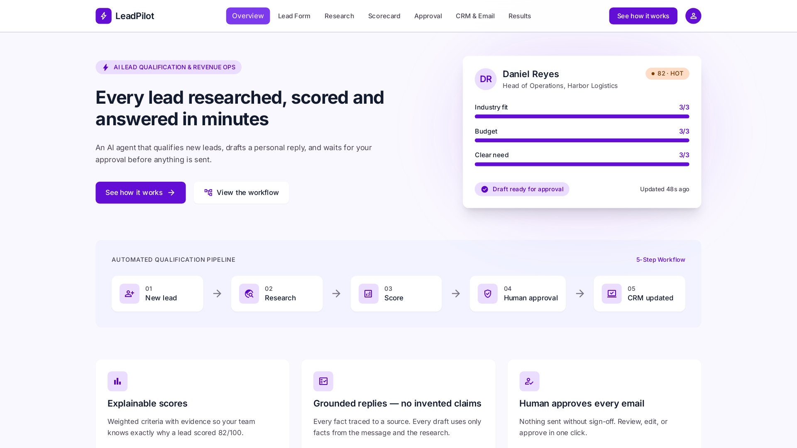
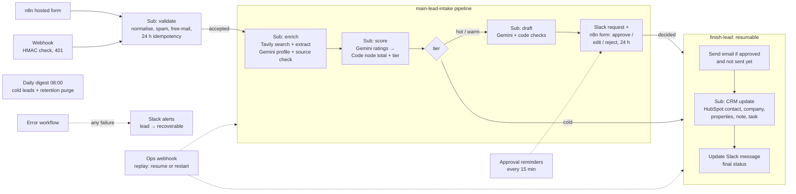

# AI Lead Qualifier (n8n) – LeadPilot



**Every new lead researched, scored and answered within minutes, with a human approving every email.**

[Live demo](#demo-and-hosting) · [2-min video](#demo-and-hosting) · [Architecture](docs/architecture.md) · [Evaluation](eval/results.md)

> The screens above and in `docs/ui/` are showcase designs for the video and README. The product itself runs in n8n (form and workflows), Slack (approval) and HubSpot (CRM).

## What it does

A lead arrives from the hosted n8n form or any form tool's webhook (HMAC-signed). Then the workflow:

1. **Checks it:** valid email, spam rules (honeypot, link stuffing, blocked phrases), personal-email flag, and duplicates (same email + message within 24 h is ignored).
2. **Researches the company:** Tavily web search, then reads the company's website and the top public pages. Gemini builds a structured profile in which every fact has a confidence level and a source URL. A code check drops anything citing a page that wasn't read. If the website is down, the lead continues with lower confidence.
3. **Scores it against your ideal-customer profile** (`config/icp.json`). Gemini rates each criterion 0–3 with a reason and evidence; **a Code node computes the 0–100 score and the hot/warm/cold tier from your weights**, so the total is deterministic and auditable.
4. **Drafts a reply** for hot and warm leads, in your style (`config/reply_style.md`), using only facts from the message and the research, with your booking link. Code checks flag forbidden claims, unsupported figures and unread sources for the reviewer.
5. **Asks a person in Slack.** The message shows the summary, score with per-criterion reasons, sources and the draft, with a button to approve, edit or reject in a short form. A reminder goes out after 4 h; after 24 h the lead becomes a manual follow-up.
6. **Sends the email and updates HubSpot:** contact (updated, never duplicated), company, `ai_lead_score` / `ai_lead_tier` / `ai_score_reasons`, a note with the research, sources and sent email, and a follow-up task. The Slack message is updated with the outcome.
7. **Cold leads** get no email: they're recorded in HubSpot with score and reasons and listed in a daily Slack digest.
8. **Failures** retry with backoff, then post to a Slack alerts channel (execution link, masked email), and the lead is left in a recoverable status that can be replayed with one call.

## Results

`make eval` runs 30 synthetic leads (10 hot, 10 warm, 10 cold, including a personal email from a good company, vague messages and an unreachable website) plus a duplicate and a spam submission, through the real workflows, and writes [`eval/results.md`](eval/results.md).

| Metric | Result |
|---|---|
| Tier accuracy (30 leads) | _run `make eval` with real keys_ |
| Spam and duplicates handled | _run `make eval`_ (the mock run: 2/2) |
| Claims in drafts traceable to the message or sources (LLM judge) | _run `make eval`_ |
| Time from submission to Slack, p50 / p95 | _run `make eval`_ (the mock run: about 2 s) |
| Estimated cost per lead (paid tiers) | _run `make eval`_ (estimate below: ≈ $0.02) |

> **Status:** the harness, the test set and the reporting are done and run in CI against mocks ([`eval/results-mock.md`](eval/results-mock.md)). The real numbers need real Gemini and Tavily keys; see [Evaluation](#evaluation). The `docs/ui` scorecard and results screens use placeholders until then.

What the automated tests prove today (CI, against mocks of every external service):

- Unsigned or tampered webhook calls get 401; duplicates within 24 h are ignored; spam is rejected and stored without personal data.
- The score always equals the weighted ratings: the exported Code node is run against an independent Python implementation on 300 seeded rating sets plus edge cases.
- Approve, approve with edits, reject and timeout each give the right email, HubSpot and Slack outcome; an existing HubSpot contact is updated, not duplicated.
- A Tavily or Gemini outage retries, then degrades (research) or alerts and leaves the lead recoverable (scoring), and the lead can be replayed.
- With `DRY_RUN=true` the full pipeline runs and nothing is posted, sent or written to HubSpot.

## Architecture



Details, contracts and statuses: [docs/architecture.md](docs/architecture.md). Workflows (one JSON file each, fixed IDs) are in [`workflows/`](workflows).

## Stack & why

| Component | Choice | Why |
|---|---|---|
| Workflow engine | n8n Community Edition 2.49.6, self-hosted, Postgres-backed | The client can see and change the flow without a developer; lead data stays on their servers. |
| Code nodes | External task runners (`n8nio/runners`) | n8n 2.x's recommended isolation for custom code. |
| Web research | Tavily search + extract (HTTP Request) | Clean, LLM-ready text from search results and pages; no scraping code. |
| LLM | Gemini 3.5 Flash (`LLM_MODEL`) via HTTP Request with `responseSchema` | Structured output, exact control; switching provider is a one-node change per step. |
| Score maths | n8n Code node | Deterministic weighted total, unit-tested against an independent implementation. |
| Leads ledger | Postgres table (`leadpilot` database, SQL migrations) | Atomic 24 h idempotency, recoverable statuses, retention purge; portable across n8n instances. |
| Approval | Slack message + n8n Wait-node form | Same reviewer experience as Slack's Send-and-Wait, plus message updates, threaded reminders and full testability. The Slack app only needs `chat:write`. |
| CRM | HubSpot CRM v3 API with n8n's HubSpot credential | Upsert by email (never duplicate), notes and tasks with associations; isolated in one sub-workflow. |
| Email | SMTP (Gmail app password or any provider) | Sends from the business's own address. |
| Tests | pytest + FastAPI mock (Tavily, Gemini, Slack, HubSpot) + mailpit | The whole workflow runs in CI with no accounts or credits. |
| Demo exposure | Cloudflare Tunnel | Public HTTPS for forms, webhooks and the approval form at $0. |
| Production | Azure Container Apps (n8n queue mode), Postgres Flexible Server, Redis, Key Vault, App Insights | See [Production deployment](#production-deployment). |

Every choice and its alternatives: [docs/DECISIONS.md](docs/DECISIONS.md).

## Quick start

Needs Docker, [uv](https://docs.astral.sh/uv/) and GNU make (Windows: run make from Git Bash).

```bash
make setup                 # Python harness + .env with generated secrets
make dev                   # n8n + Postgres + task runners → http://localhost:5678 (login: see .env)
make credentials import    # n8n credentials from .env, then import + activate the workflows
```

Then submit the form at `http://localhost:5678/form/lead-form`, or `make seed` to post the sample leads to the signed webhook. Without real keys, try it all against the mocks: `make test-e2e`.

## Configuration

Every setting is in [`.env.example`](.env.example) with a comment and where to get it. The business rules are files you edit, no workflow changes needed:

- [`config/icp.json`](config/icp.json): criteria, weights, 0–3 rating guides, tier thresholds, free-mail domains, spam rules.
- [`config/reply_style.md`](config/reply_style.md): tone, structure, sign-off, booking link and the forbidden-claims list (also enforced in code).

Modes: `DEMO_MODE=true` (mail only to `DEMO_EMAIL_ALLOWLIST`, others redirected), `DRY_RUN=true` (no Slack, HubSpot or email writes; the skipped calls are recorded on the lead), `EVAL_AUTO_APPROVE=true` (only for leads posted by `make eval`, only in demo mode).

## Setup guides

### Gemini
1. Create a key at <https://aistudio.google.com/app/apikey> → `GEMINI_API_KEY`.
2. Free tier is enough for development; its data may be used by Google, so only send synthetic or public data through it. Use the paid tier (or Vertex AI) for client data.

### Tavily
Sign up at <https://app.tavily.com> → `TAVILY_API_KEY`. The free tier has 1,000 credits a month; a lead uses about 2.

### HubSpot (private app)
1. HubSpot → Settings → Integrations → **Private Apps** → Create.
2. Scopes (least privilege): `crm.objects.contacts.read`, `crm.objects.contacts.write`, `crm.objects.companies.read`, `crm.objects.companies.write`, `crm.schemas.contacts.read`, `crm.schemas.contacts.write`.
3. Copy the token → `HUBSPOT_PRIVATE_APP_TOKEN`, then `make credentials` and `make hubspot-setup` (creates `ai_lead_score`, `ai_lead_tier`, `ai_score_reasons`, `ai_last_processed`).

### Slack
1. <https://api.slack.com/apps> → Create New App → From scratch.
2. OAuth & Permissions → Bot Token Scopes: **`chat:write`** only. Install to the workspace; copy the Bot User OAuth Token → `SLACK_BOT_TOKEN`.
3. Create `#lead-approvals` and `#lead-alerts`, invite the bot (`/invite @YourApp`) and put the channel IDs in `SLACK_APPROVAL_CHANNEL` / `SLACK_ALERTS_CHANNEL`.
4. No interactivity URL or signing secret is needed: the "Review and decide" button opens an n8n form. That form must be reachable by reviewers, so for a local demo run the tunnel (below).

### Email (Gmail or SMTP)
Gmail: turn on 2-step verification, create an app password at <https://myaccount.google.com/apppasswords>, then `SMTP_HOST=smtp.gmail.com`, `SMTP_PORT=465`, `SMTP_SECURE=true`, `SMTP_USER`, `SMTP_PASSWORD`, `EMAIL_FROM`. Any SMTP provider works the same way. Keep `DEMO_MODE=true` and put your own inbox in `DEMO_EMAIL_ALLOWLIST` while demoing.

### Public URL for demos (Cloudflare Tunnel)
1. Install `cloudflared` (<https://developers.cloudflare.com/cloudflare-one/connections/connect-networks/downloads/>).
2. `make tunnel` prints a `https://….trycloudflare.com` URL.
3. Set `N8N_WEBHOOK_URL=<that URL>/` in `.env` and `docker compose up -d n8n` to restart. The form, the signed webhook and the approval links now use the public URL.

## Evaluation

```bash
make dev && make credentials import        # with real GEMINI/TAVILY keys in .env
# .env: DEMO_MODE=true, EVAL_AUTO_APPROVE=true (eval leads are approved automatically)
make eval                                  # ~15 min on the free tier (20 s between leads)
```

The harness ([`eval/run.py`](eval/run.py)) posts each lead in [`eval/leads.jsonl`](eval/leads.jsonl) to the signed webhook, waits for the outcome in the leads table and runs an **LLM judge** on every draft: each claim must be supported by the lead's message or the research sources. It reports tier accuracy and a confusion matrix, spam/duplicate handling, grounding, p50/p95 time from submission to the approval request, tokens and Tavily credits per lead, and the paid-tier cost per lead from [`eval/prices.json`](eval/prices.json). Results are cached in `eval/.cache`, so re-runs only spend credits on changed leads; `--fresh` re-runs everything. `make eval-mock` runs the same harness against the test stack (CI).

## Costs

**Development: $0.** Self-hosted n8n, HubSpot free CRM, a free Slack workspace, Tavily free tier (1,000 credits/month), Gemini free tier, Gmail SMTP, Cloudflare Tunnel.

**Per lead, paid tiers (estimate):** about 3 Gemini 3.5 Flash calls (≈ 5k input + 1k output tokens ≈ $0.008 at the Gemini 3.8 Flash list price, a ceiling because 3.5 Flash isn't on the pricing page) and 2 Tavily credits ($0.016): **≈ $0.02–0.03 per lead**. `make eval` replaces this with measured numbers.

## Production deployment

The design is production-grade; the demo runs on free tiers. [`deploy/azure/`](deploy/azure) has the Bicep (validated in CI; the deploy workflow is disabled by default) and the runbook.

- **Architecture:** n8n in **queue mode**: `n8n-main` (editor, webhooks, forms) and autoscaling `n8n-worker` replicas on Azure Container Apps, each with a task-runner sidecar; Azure Database for PostgreSQL Flexible Server (n8n + leads ledger, 14-day point-in-time restore); Azure Cache for Redis (queue); Key Vault for n8n's own secrets, mounted as files through a managed identity (nothing secret in app settings or `$env`); a private VNet for Postgres; Azure Files for `config/`; Log Analytics + Application Insights.
- **Estimated monthly cost** (list prices, West Europe, consumption plan; check the [Azure pricing calculator](https://azure.microsoft.com/pricing/calculator/) before quoting):

| | 500 leads/month | 5,000 leads/month |
|---|---|---|
| Container Apps: main + 1 worker (0.5 vCPU / 1 GiB each + runner sidecars), always on | ≈ $115 | ≈ $125 (workers scale to 2 at peaks) |
| PostgreSQL Flexible Server | ≈ $16 (B1ms, 32 GB) | ≈ $55 (B2s, 32 GB) |
| Azure Cache for Redis Standard C0 | ≈ $40 | ≈ $40 |
| Key Vault, Files, Log Analytics | ≈ $5 | ≈ $15 |
| Gemini (paid) + Tavily, ≈ $0.02/lead | ≈ $10 | ≈ $100 |
| **Total** | **≈ $185** | **≈ $335** |

HubSpot, Slack and SMTP are the client's existing accounts. Basic-tier Redis (no SLA) saves about $25.
- **Scaling:** webhooks only enqueue work, so bursts don't block intake; add workers (`maxWorkers`) for throughput; move Postgres to General Purpose beyond a few thousand leads a month. Gemini's paid-tier rate limits are the practical ceiling, and every call already retries with backoff.
- **Security summary:** HTTPS only; HMAC-signed webhooks (401 otherwise); least-privilege HubSpot and Slack scopes; credentials encrypted by n8n with the key held in Key Vault; n8n's environment carries no API keys or passwords; no secrets in workflow JSON (CI checks); a decided lead is never emailed twice, even after a failure and replay; Code nodes isolated in task runners with only `node:crypto`; emails masked in alerts; no contact names or emails sent to the LLM except the first name for the greeting; execution data pruned after 14 days and lead rows after 30 days (HubSpot keeps the record); spam stored without personal data.

### Upgrading n8n

1. Read the release notes between the pinned version (`2.49.6`) and the target.
2. Bump the tag in `docker-compose.yml` (n8n **and** runners), `deploy/azure/main.bicep` (`n8nVersion`), and `scripts/lint_workflows.py` if node type versions change.
3. `make e2e-down && make test-e2e && make test-e2e-dryrun`: the full suite runs the real workflows on the new version.
4. Export after any node upgrade prompts in the editor (`make export`), commit, and deploy. Postgres backups (point-in-time restore) cover a rollback.

## Demo and hosting

There is no always-on hosted demo: free hosting tiers sleep, which breaks Slack approvals, and n8n's Sustainable Use License doesn't allow hosting clients' workflows as a service. The demo runs locally with `make tunnel` for a public URL, which is also how the video is recorded.

## License note

n8n Community Edition runs under the [Sustainable Use License](https://docs.n8n.io/sustainable-use-license/). Setting it up on a client's own instance for their internal use is fine. Hosting clients' workflows and credentials on your own instance as a service is not. This repository (workflows, config, scripts, tests) is MIT-licensed.

## Limitations & next steps

- Real evaluation numbers (and the README/`docs/ui` figures) need a run with real Gemini and Tavily keys.
- Reading leads from an email inbox is not implemented (out of scope); it would be a third intake workflow calling `sub-validate`.
- One CRM (HubSpot). The CRM logic is isolated in `sub-crm-update`, so another CRM is one sub-workflow.
- Approvals have no Slack-native identity: reviewers type their name in the form. Slack interactivity (signed callbacks) would add verified identity.
- n8n has no per-execution cost cap; the free-tier throttling lives in the eval harness, and production relies on paid-tier limits plus Gemini/Tavily budget alerts.

## License

MIT, see [LICENSE](LICENSE).
