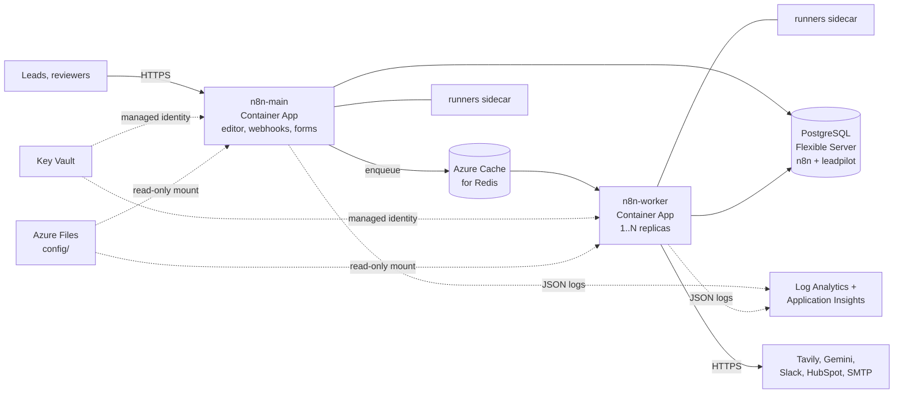

# Azure production profile

`main.bicep` deploys LeadPilot for a client on their own Azure subscription, with n8n in **queue mode**. It is validated in CI (`az bicep build` + lint) and not deployed by this repository.



| Resource | Why |
|---|---|
| Container Apps `n8n-main` (1 replica) | Editor, webhooks, hosted forms and triggers; puts executions on the queue. |
| Container Apps `n8n-worker` (1–`maxWorkers`, CPU autoscale) | Runs executions, so a burst of leads doesn't slow the editor or webhooks. |
| `runners` sidecar (`n8nio/runners`) in both | Code nodes run in a separate process (n8n's recommended external mode). |
| PostgreSQL Flexible Server 17, private access | n8n's database and the `leadpilot` leads ledger; 14-day point-in-time restore. Reachable only inside the VNet (delegated subnet + private DNS zone); no public endpoint. |
| VNet (`apps` /23, `postgres` /24) | The Container Apps environment (Consumption workload profile) and Postgres share it. |
| Azure Cache for Redis | The n8n queue (Bull). Standard tier for an SLA. |
| Key Vault + user-assigned managed identity | n8n's secrets, read at runtime and mounted as files (`*_FILE`), so workflow expressions can't read them through `$env`. API keys for Gemini, Tavily, HubSpot, Slack and SMTP live in n8n credentials, encrypted with the n8n encryption key. |
| Azure Files share `config` | `icp.json` and `reply_style.md`, mounted read-only; edit and the next lead uses them. |
| Log Analytics + Application Insights | All container logs (n8n logs JSON). |

## Deploy

```bash
az group create -n leadpilot-prod -l westeurope
cp deploy/azure/main.parameters.example.json deploy/azure/main.parameters.json   # edit it
PGPASS="$(openssl rand -base64 24)"   # keep it: every later deploy passes the same value
# First deployment only: createPlaceholderSecrets=true so the apps can start
az deployment group create -g leadpilot-prod \
  --template-file deploy/azure/main.bicep \
  --parameters @deploy/azure/main.parameters.json \
  --parameters postgresAdminPassword="$PGPASS" createPlaceholderSecrets=true
```
Later deployments (and the release workflow) use `createPlaceholderSecrets=false`, the default: the template never writes the operator's secrets, so a redeploy can't reset them.

After the first deployment:

1. **Secrets:** set the real values in Key Vault (the first deployment created them as `set-me`):
   ```bash
   KV=$(az deployment group show -g leadpilot-prod -n main --query properties.outputs.keyVaultName.value -o tsv)
   az keyvault secret set --vault-name $KV -n n8n-encryption-key --value "$(openssl rand -hex 32)"
   az keyvault secret set --vault-name $KV -n n8n-runners-auth-token --value "$(openssl rand -hex 32)"
   az keyvault secret set --vault-name $KV -n webhook-hmac-secret --value "$(openssl rand -hex 32)"
   ```
   The API keys (Gemini, Tavily, HubSpot, Slack, SMTP) are entered as n8n credentials in step 4, not in Key Vault.
   Then restart both container apps so they read the new values. **Back up `n8n-encryption-key`**: without it the credentials stored in n8n can't be decrypted.
2. **Config:** upload `config/icp.json` and `config/reply_style.md` to the `config` file share.
3. **Database:** run the migrations against the `leadpilot` database, in order. Postgres is private, so run them from inside the VNet, e.g. `az containerapp exec -n leadpilot-main -g leadpilot-prod` and `psql "host=<postgresHost> dbname=leadpilot user=leadpilotadmin sslmode=require" -f 00N_*.sql` (or a jump box / Cloud Shell with VNet access).
4. **Workflows and credentials:** in the n8n editor (`editorUrl` output), create the owner account, then import `workflows/*.json` and create the 7 credentials (same names as `scripts/n8n_admin.py` › `CREDENTIALS`; the Postgres one uses SSL). Activate the workflows sub-workflows first (`make import` shows the order).
5. **Slack and HubSpot:** point the Slack app and the form tools at `https://<publicHost>/`; run `make hubspot-setup` with the client's token.

## Operations

- **Upgrades:** see "Upgrading n8n" in the main README. Bump `n8nVersion` (main, worker and runners use the same tag), deploy, and check `/healthz/readiness`.
- **Backups:** Flexible Server keeps automatic backups for 14 days (point-in-time restore, `backupRetentionDays`). Enable geo-redundant backup for a second region. Workflows are also in git; credentials can be recreated from Key Vault.
- **Scaling:** raise `maxWorkers` for throughput; Postgres to General Purpose (`GP_Standard_D2ds_v5`) beyond a few thousand leads a month. One main replica is enough: it only receives webhooks and enqueues work.
- **Security:** HTTPS only (Container Apps ingress), Key Vault RBAC, secrets mounted as files (never in app settings or `$env`), private Postgres with SSL, n8n user accounts with an owner + members, execution data pruned after 14 days, leads purged after 30 days. Redis is reached over TLS with its access key; add a private endpoint for it if the client's policy requires private-only data stores.

## GitHub deploy workflow

`.github/workflows/deploy.yml` deploys on a release tag but is **disabled by default**: it runs only when the repository variable `AZURE_DEPLOY_ENABLED` is `true` and the `AZURE_*` secrets for OIDC login are set.
