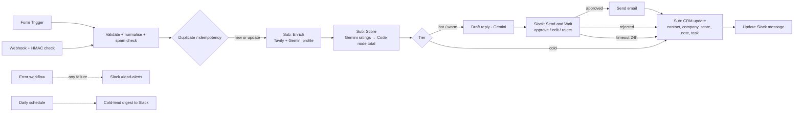

# SPEC – AI Lead Qualification Agent (n8n)
**Repo:** `ai-lead-qualifier-n8n` · **Priority:** 5 · **Follows:** `docs/CONVENTIONS.md`

## 1. Goal
A new lead arrives from a website form or any form tool's webhook. The workflow:
1. Researches the lead's company on the web.
2. Scores the lead against the business's ideal-customer profile, with reasons and sources.
3. Drafts a personalised reply.
4. Asks a person in Slack to approve, edit or reject it.
5. Sends the email, then updates HubSpot with the contact, company, score, summary and a follow-up task.

It's built as an n8n workflow, so the client can see it and change it without a developer.

**One-line value statement:** "Every new lead researched, scored and answered within minutes, with a human approving every email."

## 2. Who it's for and the problem
B2B service businesses, agencies and SaaS companies. Leads wait hours or days for a reply, sales staff research every lead by hand, and good leads go cold. This is also the most common Upwork job type: "AI agent + n8n/Make/Zapier".

## 3. Scope
### In scope (MVP)
1. **Intake:**
   - **n8n Form Trigger:** a hosted lead form with name, email, company, website, role, message, and budget range (optional).
   - **Webhook:** generic JSON input for any form tool (Typeform, Webflow, WordPress). Requests must carry an HMAC-SHA256 signature header using a shared secret; unsigned or invalid requests are rejected with 401.
2. **Validate and normalise:**
   - Valid email format.
   - Website domain worked out from the URL, or from the email domain if the URL is empty.
   - Free-mail domains (gmail.com etc.) flagged as "personal email".
   - Obvious spam (honeypot field, link-stuffed messages) rejected.
3. **Duplicate check:** search HubSpot by email. An existing contact is updated rather than duplicated. An n8n idempotency check on a lead hash (email + message) ignores the same submission twice within 24 hours.
4. **Enrichment:**
   - Tavily search plus extraction of the company's website and one or two public pages about the company.
   - Gemini Flash then produces a structured company profile: what they do, industry, approximate size, location, notable facts. Each fact comes with a confidence level and source URLs.
   - If the website can't be reached, the workflow continues with lower confidence.
5. **Scoring (explainable):**
   - The ideal-customer profile rubric lives in a config file: `config/icp.json`, with criteria, weights and rules. Example criteria: industry fit, company size, role seniority, budget, need expressed in the message.
   - Gemini rates each criterion from 0 to 3 with a one-line reason and evidence.
   - **A Code node then computes the final score from 0 to 100 using the weights.** The model never invents the total, so the score is deterministic and auditable.
   - Tiers: hot (≥70), warm (40–69), cold (<40). The thresholds are configurable.
6. **Reply draft:**
   - Written only for hot and warm leads, by Gemini.
   - It may only use facts from the lead's message and the enrichment profile: no invented claims, prices or promises.
   - It follows a tone and template in `config/reply_style.md`, and includes the booking link from config.
7. **Human approval in Slack:**
   - A message to the approval channel showing: lead summary, score with per-criterion reasons, sources, and the draft.
   - Uses Send and Wait for Response with a custom form: decision (Approve / Approve with edits / Reject), an edited email body, and a reject reason.
   - Timeout of 24 hours, with a reminder at 4 hours.
   - On timeout the lead goes to the "needs manual follow-up" status, and HubSpot gets a task.
8. **After approval:**
   - The email is sent through Gmail or SMTP from the business address.
   - The Slack message is updated with the outcome.
   - HubSpot gets: the contact (created or updated) and its company (created or associated), with custom properties `ai_lead_score`, `ai_lead_tier` and `ai_score_reasons`, a note containing the enrichment summary, sources and the sent email, and a follow-up task due in `FOLLOW_UP_DAYS` (default 3).
9. **Cold leads:** no email is drafted. They're recorded in HubSpot with score and reasons, and summarised in a daily Slack digest (scheduled workflow).
10. **Error handling and alerts:**
    - Every external call has a timeout and retries with backoff (n8n node retry settings).
    - A dedicated **error workflow** posts failures to a Slack alerts channel, with the execution link and lead email (masked).
    - A failed step leaves the lead in a recoverable state ("enrichment failed – scored on form data only"), never lost.
11. **Evaluation:**
    - 30 synthetic leads with expected tiers.
    - Report:
      - Tier accuracy.
      - Grounding: draft claims traceable to the message or sources.
      - Time from submission to Slack message, at p50 and p95.
      - Tokens and Tavily credits per lead.

### Out of scope
- Reading leads from an email inbox. Note it as a next step.
- Make.com and Zapier versions.
- CRMs other than HubSpot. The workflow's CRM step is isolated in a sub-workflow, so swapping is contained.
- Sending without human approval.
- A custom web UI: the intake form is n8n's hosted form, and the review happens in Slack.
- A hosted public demo that's always on, because the free hosting doesn't fit n8n (see section 7).

## 4. Stack (decided)
| Component | Choice | Why |
|---|---|---|
| Workflow engine | **n8n Community Edition, self-hosted** (Docker, pinned version) | Clients want to own, see and edit the flow without a developer. Self-hosting keeps lead data on their servers. Free under n8n's Sustainable Use License for the client's internal use. |
| n8n database | PostgreSQL | Required for reliable production n8n (instead of the default SQLite). The same database type as every other repo. |
| Web research | Tavily API via an HTTP Request node | Search and page extraction return clean text ready for an LLM, with no scraping code to maintain. The free tier covers development. |
| LLM | Gemini Flash (free tier) via an HTTP Request node, with a JSON response schema | Exact control over structured output. The base URL comes from an environment variable, so tests can point it at a mock, and switching provider is a one-node change. |
| Score calculation | n8n Code node (JavaScript) | A deterministic, weighted total from the model's per-criterion ratings, so it's explainable and testable. |
| CRM | HubSpot free CRM (native n8n HubSpot node, private-app token) | Free, widely used by small businesses, and the native node is what clients recognise. |
| Approval | Slack (native node, Send and Wait for Response) | Sales teams already live in Slack, and the workflow resumes as soon as someone responds. |
| Email | Gmail node (OAuth) or SMTP node | Sends from the business's own address. |
| Workflows in git | n8n CLI export and import (`make export`, `make import`), one JSON file per workflow in `/workflows` | Version control and review for workflows, and a one-command setup on a fresh instance. |
| Credentials setup | Created from `.env` through n8n's public REST API by `make credentials`, or by documented manual steps | No secrets ever exported or committed. |
| Test harness | Python + pytest + a small FastAPI mock server for the HTTP-based services (Tavily, Gemini) | Lets CI run the whole workflow without real accounts or credits. |
| Local demo exposure | Cloudflare Tunnel (free, `cloudflared`) | A public HTTPS URL for Slack callbacks and webhooks when recording or demoing, at $0. |
| Development MCP servers | None by default | There's no Next.js UI and no Neon. Note in `AGENTS.md` that the build agent may use n8n's own MCP features if a newer n8n version provides them, and should record that in `DECISIONS.md`. |

**Not used, on purpose:** Make or Zapier, a Python agent version, LangChain, a vector database, a custom UI, Redis (in the demo).

## 5. Workflow design
Main workflow, plus sub-workflows so each piece can be tested and swapped:

**Workflows in `/workflows`:**
- `main-lead-intake.json`
- `sub-enrich.json`
- `sub-score.json`
- `sub-crm-update.json`
- `error-handler.json`
- `daily-cold-digest.json`

## 6. Data and config
- `config/icp.json`: criteria (name, description, weight, rating guide for 0–3), tier thresholds, free-mail domains.
- `config/reply_style.md`: tone, structure, sign-off, booking link placeholder, forbidden claims.
- **HubSpot custom contact properties:** `ai_lead_score` (number), `ai_lead_tier` (dropdown), `ai_score_reasons` (multi-line text), `ai_last_processed` (datetime). They're created by `make hubspot-setup` through the HubSpot API.
- **n8n execution data:** pruning is enabled (`EXECUTIONS_DATA_PRUNE=true`, maximum age 14 days) so the database doesn't fill up. Lead personal data stays in HubSpot, not in long-lived n8n logs.

## 7. Demo and hosting
- **Development:** `docker compose up` starts n8n + Postgres + the mock server (test profile).
- **Live demo:**
  - Run locally, then `make tunnel` (Cloudflare Tunnel) gives a public HTTPS URL for the form, webhooks and Slack interactivity.
  - Used for recording the video and for live client calls.
  - There's no always-on hosted demo: the free hosting tiers sleep, which breaks Slack approvals, and keeping one awake would use up the free hours other projects need.
- **Showcase visuals:**
  - `docs/ui/` holds Stitch designs: landing page, scorecard, explainer frames, results.
  - They're used for the demo video, the README and the Upwork cover. **They are not built as an app.**
  - The real n8n, Slack and HubSpot moments in the video are screen recordings.
  - The README results section may reuse the scorecard and results designs, filled with the real numbers from `eval/results.md`.
- **What the portfolio shows:**
  - The demo video.
  - Screenshots.
  - The importable workflow JSON files.
  - The evaluation results.
- **Demo data:**
  - Synthetic leads use real public company websites (public information only), with fake contact names and `example.test` email addresses.
  - Emails are sent only to an allow-listed demo inbox (`DEMO_EMAIL_ALLOWLIST`).

## 8. Evaluation
- **Test set:** 30 synthetic leads in `eval/leads.jsonl`:
  - 10 expected hot, 10 warm, 10 cold.
  - Includes tricky cases: a personal email from a good company, a vague message, an unreachable website, a duplicate submission and a spam submission.
- **Harness:** `make eval` posts each lead to the signed webhook, and approves automatically in eval mode (`EVAL_AUTO_APPROVE=true`, which only works when `DEMO_MODE=true`). It then reads results from HubSpot or the n8n execution data.
- **Metrics:**
  - Tier accuracy and a confusion matrix.
  - Duplicate and spam handling, which must be 100%.
  - **Draft grounding:** an LLM judge checks every claim in the draft against the message and sources.
  - p50/p95 time from submission to Slack message.
  - Tokens and Tavily credits per lead, plus the estimated paid-tier cost per lead.
- **Free-tier handling:** the harness throttles and caches.
- **Output:** `eval/results.md` and `eval/results.json`, committed.

## 9. Acceptance criteria
- [ ] `make setup && make dev` starts n8n + Postgres. Then `make credentials`, `make import` and `make hubspot-setup` leave a working instance with all workflows active, from a fresh clone.
- [ ] A form submission reaches Slack within about a minute, with the summary, score, per-criterion reasons, sources and draft.
- [ ] Approve, approve-with-edits, reject and a 24-hour timeout each lead to the correct email, HubSpot and Slack outcome. The timeout is tested with a short override.
- [ ] Webhook calls without a valid HMAC signature get 401. Duplicate submissions within 24 hours are ignored. An existing HubSpot contact is updated, not duplicated.
- [ ] The final score always equals the weighted total of the per-criterion ratings, tested with fixed ratings.
- [ ] Forcing Tavily or Gemini to fail (via the mock) triggers retries, then the error workflow posts to the alerts channel, and the lead ends in a recoverable status.
- [ ] Cold leads appear in the daily digest and in HubSpot without an email.
- [ ] Workflows are exported to `/workflows` with no credentials or secrets inside (checked by CI).
- [ ] `make eval` reproduces the README numbers.
- [ ] **CI:**
  - Lint the workflow JSON: it parses, pinned node versions, retries set on external-call nodes, error workflow assigned, no hardcoded secrets.
  - Boot n8n in Docker, import the workflows, and run the pytest end-to-end suite against the mock server with `DRY_RUN=true`, which skips the real HubSpot, Slack and email writes.
- [ ] **Production readiness** (CONVENTIONS section 10, adapted):
  - n8n encryption key handling.
  - Execution pruning.
  - Postgres backups documented.
  - Webhook HMAC.
  - Least-privilege HubSpot private-app scopes and Slack bot scopes.
  - Personal data retention.
  - Pinned n8n version with an upgrade runbook.
  - `deploy/azure/` Bicep validates in CI. It defines **n8n queue mode**: main + workers on Azure Container Apps, Azure Database for PostgreSQL Flexible Server, Azure Cache for Redis, Key Vault for the encryption key and credentials, and Application Insights.
  - README "Production deployment" section with a monthly cost estimate at 500 and 5,000 leads a month.
- [ ] **README includes:**
  - A "License note": n8n Community Edition runs under the Sustainable Use License. It's fine to set it up on a client's own instance for their internal use. It isn't fine to host clients' workflows and credentials on your own instance as a service.
  - Setup steps for the HubSpot private app, Slack app (interactivity URL, scopes, signing secret), Gmail/SMTP, Tavily and Gemini.
- [ ] `AGENTS.md` "Gotchas" lists:
  - Always edit workflows in n8n and then `make export`. Never hand-edit the JSON unless n8n is stopped and you re-import.
  - Credentials are never exported.
  - The Slack interactivity URL must be public (use the tunnel).
  - Gemini free-tier limits.
  - Score maths lives in the Code node.
  - `DRY_RUN` and `EVAL_AUTO_APPROVE` flags.
  - Execution pruning.
- [ ] Everything in CONVENTIONS section 8 is done, including the AI-tool handoff check in section 3a.

**Not applicable from CONVENTIONS section 10, and why:**
- Built-in user accounts: n8n has its own owner and member accounts.
- Alembic migrations: n8n manages its own schema.
- Playwright: there's no custom UI.

## 10. Environment variables
`N8N_ENCRYPTION_KEY`, `N8N_HOST`, `WEBHOOK_URL`, `N8N_API_KEY` (for `make credentials` / `make import`), `DB_TYPE=postgresdb`, `DB_POSTGRESDB_HOST`, `DB_POSTGRESDB_DATABASE`, `DB_POSTGRESDB_USER`, `DB_POSTGRESDB_PASSWORD`, `EXECUTIONS_DATA_PRUNE=true`, `EXECUTIONS_DATA_MAX_AGE=336`, `GENERIC_TIMEZONE`, `GEMINI_API_KEY`, `GEMINI_BASE_URL`, `LLM_MODEL`, `TAVILY_API_KEY`, `TAVILY_BASE_URL`, `HUBSPOT_PRIVATE_APP_TOKEN`, `SLACK_BOT_TOKEN`, `SLACK_SIGNING_SECRET`, `SLACK_APPROVAL_CHANNEL`, `SLACK_ALERTS_CHANNEL`, `SMTP_HOST`, `SMTP_PORT`, `SMTP_USER`, `SMTP_PASSWORD`, `EMAIL_FROM`, `BOOKING_LINK`, `WEBHOOK_HMAC_SECRET`, `FOLLOW_UP_DAYS=3`, `APPROVAL_TIMEOUT_HOURS=24`, `DEMO_MODE`, `DEMO_EMAIL_ALLOWLIST`, `DRY_RUN=false`, `EVAL_AUTO_APPROVE=false`.

## 11. Expected development cost
**$0.**
- n8n Community Edition, self-hosted locally.
- HubSpot free CRM.
- A free Slack workspace.
- Tavily free tier (1,000 credits a month).
- Gemini Flash free tier.
- Gmail SMTP.
- Cloudflare Tunnel.

## 12. Upwork case study inputs
- **Problem:** slow lead response and manual research.
- **Solution:** an n8n agent that researches, scores, drafts, gets human approval and updates the CRM.
- **Result:** "Researches and scores a lead in ~N s; X% tier accuracy on 30 test leads; 100% of email claims traceable to sources; approval in one click in Slack; ~$0.00M per lead in production."
