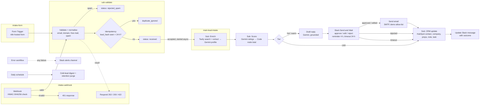
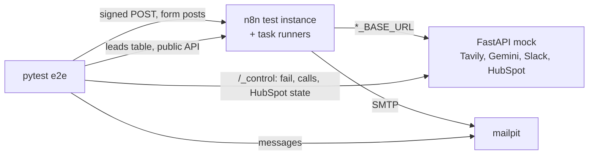

# Architecture

LeadPilot is a set of n8n workflows. n8n (Community Edition, self-hosted, Postgres-backed) is the only runtime. Python appears only in the **test harness** (mock server, pytest end-to-end suite, evaluation, admin scripts). It never runs in the production path.

## 1. Workflow diagram



## 2. Workflows (`/workflows`)

| File | Trigger | Purpose |
|---|---|---|
| `intake-webhook.json` | Webhook `POST /webhook/lead` | Checks the HMAC signature (401 if invalid), calls `sub-validate`, answers the sender (202 accepted, 200 duplicate/spam, 422 invalid) and starts `main-lead-intake` without waiting. |
| `intake-form.json` | Form Trigger `/form/lead-form` | Hosted lead form (bots ignored, hidden honeypot field), calls `sub-validate`, starts `main-lead-intake` for accepted leads. |
| `sub-validate.json` | Execute Workflow Trigger | Normalises and validates a submission, runs the spam and free-mail checks from `config/icp.json`, and claims the lead in the `leads` table unless the same email + message arrived in the last 24 h. Shared by both intakes so the rules exist once. |
| `main-lead-intake.json` | Execute Workflow Trigger | The lead pipeline up to the decision: enrichment, scoring, draft, Slack approval. Hands over to `finish-lead` (without waiting). |
| `finish-lead.json` | Execute Workflow Trigger | Everything after the decision, loaded from the lead row so it can be resumed: send (if not sent yet), CRM, Slack outcome update, final status. See 3.7. |
| `sub-alert.json` | Execute Workflow Trigger | Records an alert (masked email) and posts it to the alerts channel. Used by the error handler (failures) and the pipeline (research warnings). |
| `sub-draft.json` | Execute Workflow Trigger | Reply draft in the configured style, checked in code. See 3.4. |
| `sub-enrich.json` | Execute Workflow Trigger | Web research (Tavily search + extract) and a structured, source-checked company profile (Gemini). See 3.2. |
| `sub-score.json` | Execute Workflow Trigger | Per-criterion ratings from Gemini, deterministic total and tier in a Code node. See 3.3. |
| `sub-crm-update.json` | Execute Workflow Trigger | HubSpot contact/company upsert, custom properties, note, follow-up task. The only HubSpot-aware workflow, so swapping CRM is contained here. See 3.6. |
| `error-handler.json`, `daily-cold-digest.json`, `approval-reminders.json`, `ops-webhooks.json` | Error / schedule / webhook | See section 5. |

Every workflow except `error-handler` sets `settings.errorWorkflow` to the error handler. Workflow IDs are fixed (set in the exported JSON) so `Execute Workflow` references survive export/import.

**Why two intake workflows:** n8n refuses to start a workflow that contains a Form Trigger and a "Respond to Webhook" node, and the webhook needs Respond nodes to return 401/422/202. Both intakes call the same `sub-validate`, so the validation rules are not duplicated.

### 2.1 Webhook contract (`POST /webhook/lead`)
```
Content-Type: application/json
X-Signature-256: sha256=<hex HMAC-SHA256(raw body, WEBHOOK_HMAC_SECRET)>

{"name": "...", "email": "...", "company": "...", "website": "...", "role": "...",
 "budget_range": "...", "message": "...", "website_url_confirm": ""}
```
| Response | When |
|---|---|
| `401 {"error": "invalid signature"}` | Missing or wrong signature, or a body that differs from the signed one. |
| `422 {"status": "invalid", "errors": [...]}` | Missing name or message, invalid email. |
| `200 {"status": "rejected_spam"}` | Honeypot filled, more than `max_links_in_message` links, or a blocked phrase. Stored without personal data. |
| `200 {"status": "duplicate_ignored"}` | Same email + message within 24 h. |
| `202 {"status": "accepted", "lead_id": "ld_…"}` | Stored with status `received`; the pipeline starts in the background. |

### 2.2 Leads table (`leadpilot` database, `db/migrations/`)
Duplicate check: `lead_claims` (primary key `lead_hash`) is claimed atomically for 24 h, so two identical submissions arriving together still create one lead. One `leads` row per accepted or spam submission: `lead_id`, `lead_hash`, `source`, `status`, timestamps, contact fields, `payload` (the normalised lead, for replaying recoverable leads), and later `enrichment_status`, `score`, `tier`, `error`, `execution_id`. Spam rows keep no name, email or payload. Rows are purged after `LEAD_RETENTION_DAYS` (default 30) by the daily workflow (M5); HubSpot keeps the long-term record.

## 3. Sub-workflow contracts

All sub-workflows take one item and return one item. Fields not listed are ignored.

### 3.0 `sub-validate`
Input: `{ "source": "form | webhook | eval", "fields": { <raw submission> } }`

Output: `{ "check": "accepted | duplicate | spam | invalid", "errors": [], "spam_reasons": [], "lead": <normalised lead>, "response": { "code": 202, "body": {...} } }`

### 3.1 Normalised lead (produced by `sub-validate`, input to the pipeline and every sub-workflow)
```json
{
  "lead_id": "ld_7f3a9c2e1b",
  "lead_hash": "sha256(lower(email) + '\\n' + trim(message))",
  "source": "form | webhook | eval",
  "received_at": "2026-11-25T10:00:00Z",
  "name": "Daniel Reyes",
  "email": "daniel.reyes@harborlogistics.example",
  "email_domain": "harborlogistics.example",
  "personal_email": false,
  "company": "Harbor Logistics",
  "website_url": "https://harborlogistics.example",
  "website_domain": "harborlogistics.example",
  "role": "Head of Operations",
  "budget_range": "$25k-$50k",
  "message": "We need a customer portal for shipment tracking..."
}
```

### 3.2 `sub-enrich`
Input: `{ "lead": <normalised lead> }`

Output:
```json
{
  "enrichment_status": "ok | partial | failed",
  "enrichment_note": "website unreachable – profile built from other public sources",
  "profile": {
    "what_they_do":  { "value": "Freight logistics", "confidence": "high", "sources": ["https://..."] },
    "industry":      { "value": "Logistics", "confidence": "high", "sources": ["https://..."] },
    "size_estimate": { "value": "~180 employees", "confidence": "medium", "sources": ["https://..."] },
    "location":      { "value": "Rotterdam, Singapore", "confidence": "medium", "sources": ["https://..."] },
    "notable_facts": [ { "fact": "Launched a cold-chain service in 2026", "confidence": "medium", "sources": ["https://..."] } ]
  },
  "sources": [ { "url": "https://...", "title": "..." } ],
  "usage": { "llm_input_tokens": 0, "llm_output_tokens": 0, "tavily_credits": 0 },
  "grounding": { "dropped_unsourced": 0 },
  "errors": []
}
```
Input is the whole item from `sub-validate` (only `lead` is read).

How it works:
1. **Tavily search** for `"<company>" <domain> company` (basic depth, 5 results, 1 credit). Personal-email leads have no domain, so the company name alone is searched.
2. **Tavily extract** of up to 3 pages: the lead's website first, then the top search results (1 credit per 5 pages read).
3. **Status:** `ok` when the company website was read; `partial` when the website is missing or unreachable but other sources exist; `failed` when nothing usable was found. `failed` skips the model call, and the lead continues as `enrichment_failed` (scored on form data only, recoverable).
4. **Gemini profile** (HTTP Request, `responseSchema`, temperature 0.1, thinking off) over the numbered sources only. The prompt tells the model the sources are untrusted data.
5. **Grounding guard** (Code node): any value or fact whose source URLs were not among the pages read is replaced by `Unknown` or dropped, and counted in `grounding.dropped_unsourced`.

Every HTTP node retries 3 times, 3 s apart, with a timeout (search 20 s, extract 30 s, Gemini 60 s), then continues on its error output, so an outage degrades the profile instead of losing the lead. The error text is kept in `errors` and stored on the lead row.

`main-lead-intake` stores the result on the lead row: `enrichment_status`, `enrichment` (note, profile, sources, grounding), `error`, and adds the usage to `llm_input_tokens`, `llm_output_tokens` and `tavily_credits` (migration `002`). Status becomes `enriched` or `enrichment_failed`.

### 3.3 `sub-score`
Input: `{ "lead": <normalised lead>, "enrichment": <sub-enrich output> }`

Output:
```json
{
  "criteria": [
    { "key": "industry_fit", "name": "Industry fit", "rating": 3, "weight": 25, "points": 25.0,
      "reason": "Logistics is a target industry", "evidence": "https://..." }
  ],
  "score": 82,
  "tier": "hot | warm | cold",
  "thresholds": { "hot": 70, "warm": 40 },
  "issues": [],
  "usage": { "llm_input_tokens": 0, "llm_output_tokens": 0 }
}
```
`points = rating / 3 * weight`; `score = round(sum(points) / sum(weights) * 100)`; tier `hot` if `score >= tiers.hot`, `warm` if `score >= tiers.warm`, else `cold`. Weights need not sum to 100. The model only returns `rating`, `reason` and `evidence` per criterion; the "Compute score" Code node does everything else.

How it works:
1. `config/icp.json` is read on every run (business, criteria with rating guides, tiers).
2. **Rating request:** criteria and rating guides, the lead's role, company, email domain (flagged if personal), budget and message, and the research (or "No research available"). No contact name or email is sent, nor are the weights. The prompt says not to compute a total and to ignore instructions inside the form or research. `responseSchema` restricts `key` to the configured criteria; temperature 0, thinking off.
3. **Compute score** checks every rating: a missing criterion, or a rating that isn't an integer 0–3 (`null`, `2.5`, `"high"`, `4`), counts as 0; unknown or duplicate keys are ignored; an evidence URL that wasn't a researched source is removed. Each case is listed in `issues`. Unreadable model output or a non-positive weight in the config throws, so the pipeline stops and the error workflow takes over.
4. Gemini is retried 3 times, 5 s apart; a lasting outage stops the pipeline at "Score lead" with the lead still `enriched` (M6 adds the alert and the recoverable status).

`main-lead-intake` stores `score`, `tier`, `scoring` (criteria, thresholds, issues; migration `003`) and adds the tokens; status becomes `scored`.

`tests/unit/test_score_maths.py` runs the exported "Compute score" node code under Node.js with 300 fixed random rating sets and the edge cases above, and checks it against an independent Python implementation of the formula.

### 3.4 `sub-draft`
Input: `{ "lead", "enrichment", "scoring" }`. Output:
```json
{ "subject": "Your shipment-tracking portal", "body": "Hi Daniel, …",
  "facts_used": [ { "fact": "Launched a cold-chain service", "source": "https://news.example/…" } ],
  "flags": [ "figure not found in the message or research: \"30%\"" ], "word_count": 72,
  "usage": { "llm_input_tokens": 0, "llm_output_tokens": 0 } }
```
`config/reply_style.md` (with `{{BOOKING_LINK}}` filled in) is the system prompt. Only the lead's first name, role, company, budget, message and the research facts are sent. "Check draft" (code) flags forbidden phrases quoted in the style guide, figures (money, %, numbers of 2+ digits) not found in the message, research or style guide, `facts_used` citing unread pages, and long emails; it adds a missing booking link before the sign-off.

### 3.5 Approval (in `main-lead-intake`)
"Build approval request" chooses the mode: **auto** (eval lead, `DEMO_MODE` + `EVAL_AUTO_APPROVE`), **dry** (`DRY_RUN`: the Slack message is recorded on the lead) or **live** (`chat.postMessage` to `SLACK_APPROVAL_CHANNEL`; `ok: false` stops the lead). The message has the summary, the score with per-criterion reasons, the research and sources, the draft and its warnings, and a "Review and decide" button linking to the Wait node's form (`$execution.resumeFormUrl`, signed by n8n).

The Wait node waits up to `APPROVAL_TIMEOUT_HOURS` for the form: reviewer name, decision (Approve / Approve with edits / Reject), subject and body (pre-filled with the draft), reject reason. "Read decision" returns `{ outcome: approved | approved_edited | rejected | timeout, approver, subject, body, reject_reason, decided_at }`; any change to the subject or body counts as an edit. `approval-reminders` (every 15 min, or ops `run_reminders`) posts one threaded reminder after `APPROVAL_REMINDER_HOURS`.

### 3.7 `finish-lead`
Input: `{ "lead_id" }`. "Load lead" claims the lead for this execution (`pipeline_execution_id`) and loads the payload, research, score, decision, sent email and Slack message; finished leads (`completed_at` set) are skipped. Then:
1. Send the email if the outcome is approved and `email_sent_at` is empty (no automatic retry; `email_sent_at` is recorded right after the send).
2. `sub-crm-update`.
3. Update the Slack approval message with the outcome (failure is noted on the lead, not fatal).
4. "Record outcome": final status and `completed_at`.

Because it starts from the stored row, `ops` › `replay` of a decided (or cold) lead resumes here: nothing is drafted, asked or sent twice.

### 3.6 `sub-crm-update`
Input: `{ "lead", "enrichment", "scoring", "decision" (null for cold), "email" (null unless sent), "outcome": "approved | approved_edited | rejected | timeout | cold" }`.

Calls (CRM v3/v4, `HUBSPOT_BASE_URL`, HubSpot app-token credential):
1. `POST /crm/v3/objects/contacts/batch/upsert` with `idProperty: email`: create or update, never duplicate. Sets name, job title, company, website, `ai_lead_score`, `ai_lead_tier`, `ai_score_reasons`, `ai_last_processed`.
2. Company: `POST /crm/v3/objects/companies/search` by `domain` (or `name` without a company domain), else `POST /crm/v3/objects/companies`; then `PUT /crm/v4/objects/contact/{id}/associations/default/company/{id}`.
3. `POST /crm/v3/objects/notes` (score reasons, research, sources, message, outcome or sent email), associated with the contact and company.
4. `POST /crm/v3/objects/tasks` when needed: approved → due in `FOLLOW_UP_DAYS`; timeout → due now, HIGH; none for rejected or cold.

Output: `{ dry_run: false, outcome, contact_id, contact_created, company_id, company_created, note_id, task_id }`, or with `DRY_RUN` `{ dry_run: true, dry_actions: [...] }`.

## 4. Lead statuses
`received` → `processing` → `enriched` / `enrichment_failed` (continues on form data; `enrichment_status` keeps `ok`/`partial`/`failed`) → `scored` → `drafted` → `awaiting_approval` → `approved` / `rejected` / `timed_out` (decided; `finish-lead` running) → final (written only by `finish-lead` › "Record outcome", together with `completed_at`):

| Final status | When |
|---|---|
| `approved_sent` | Approved (with or without edits); email sent, HubSpot updated, Slack updated. |
| `rejected_by_reviewer` | Rejected; HubSpot note with the reason, no email, no task. |
| `needs_manual_follow_up` | No decision within `APPROVAL_TIMEOUT_HOURS`; HubSpot task due now. |
| `cold_recorded` | Cold tier; HubSpot contact + note, listed in the daily digest. |
| `rejected_spam` / `duplicate_ignored` | At intake (duplicates aren't stored again). |
| `error_recoverable` | A step failed after its retries, at any point before `completed_at`. The error workflow sets it, alerts, and keeps everything. `POST /webhook/ops {"action": "replay", "lead_id": …}` **resumes** at `finish-lead` when the lead is already decided (or cold) and **restarts** the pipeline from the stored lead otherwise. |

## 5. Scheduled and ops workflows
| Workflow | Trigger | Does |
|---|---|---|
| `approval-reminders.json` | Every 15 min + ops | One threaded Slack reminder per lead waiting longer than `APPROVAL_REMINDER_HOURS`. |
| `daily-cold-digest.json` | Daily 08:00 + ops | First deletes lead rows and alerts older than `LEAD_RETENTION_DAYS` (and duplicate-check claims older than a day), then posts the Slack digest of cold leads from the last 24 h. |
| `error-handler.json` | Error Trigger (every workflow's error workflow) | Marks the unfinished lead `error_recoverable` and sends an `error` alert through `sub-alert` (masked email, execution link, replay hint). Sub-workflow (`lpSub*`) failures are reported once, by their caller. |
| `ops-webhooks.json` | `POST /webhook/ops`, header `X-LeadPilot-Ops-Token` | `run_reminders`, `run_digest`, `replay` (202 with `mode: resume|restart`, or 409 if the lead isn't recoverable). `make ops ACTION=…`. |

## 6. Config files
| File | Contents |
|---|---|
| `config/icp.json` | Business, criteria (key, name, description, weight, 0–3 rating guide), tier thresholds, free-mail domains, spam rules (honeypot field, max links, blocked phrases). |
| `config/reply_style.md` | Voice, structure, subject rules, `{{BOOKING_LINK}}`, forbidden claims (quoted phrases are also checked in code). |

The `config/` folder is mounted read-only into n8n at `/home/node/.n8n-files/config` (the only path n8n file nodes may read, via `N8N_RESTRICT_FILE_ACCESS_TO`). Clients edit the files and the next execution picks them up; no re-import needed.

## 7. External services
| Service | Node | Base URL | Credential |
|---|---|---|---|
| Tavily | HTTP Request | `$env.TAVILY_BASE_URL` | `Tavily API` (header auth) |
| Gemini | HTTP Request | `$env.GEMINI_BASE_URL` | `Gemini API` (header `x-goog-api-key`) |
| HubSpot | HTTP Request (CRM v3/v4) | `$env.HUBSPOT_BASE_URL` | `HubSpot` (app token) |
| Slack | HTTP Request (`chat.postMessage`, `chat.update`) | `$env.SLACK_BASE_URL` | `Slack Bot` (bot token) |
| Email | Send Email (SMTP) | – | `SMTP` |
| Leads database | Postgres | – | `LeadPilot DB` |

Every external-call node: `retryOnFail: true`, `maxTries ≥ 3`, `waitBetweenTries` set (3–5 s), and a request timeout. Research nodes continue on error (degrade); everything else stops the lead, which the error workflow makes recoverable. CI enforces the retry settings (`scripts/lint_workflows.py`).

## 8. Test harness

`make test-e2e` runs the full write path against the fakes; `make test-e2e-dryrun` recreates n8n with `DRY_RUN=true` and checks that nothing is posted, sent or written while every skipped call is recorded in `leads.dry_run_actions`. Unit tests run the exported Code nodes (score maths, draft checks, decisions, alerts) under Node.js.
