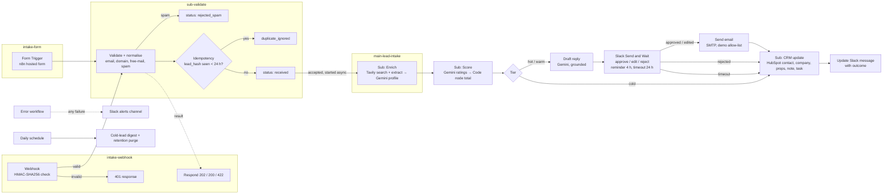
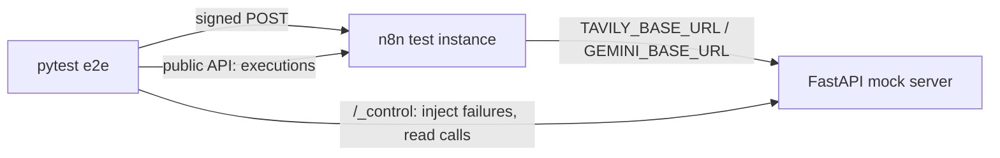

# Architecture

LeadPilot is a set of n8n workflows. n8n (Community Edition, self-hosted, Postgres-backed) is the only runtime. Python appears only in the **test harness** (mock server, pytest end-to-end suite, evaluation, admin scripts). It never runs in the production path.

## 1. Workflow diagram



## 2. Workflows (`/workflows`)

| File | Trigger | Purpose |
|---|---|---|
| `intake-webhook.json` | Webhook `POST /webhook/lead` | Checks the HMAC signature (401 if invalid), calls `sub-validate`, answers the sender (202 accepted, 200 duplicate/spam, 422 invalid) and starts `main-lead-intake` without waiting. |
| `intake-form.json` | Form Trigger `/form/lead-form` | Hosted lead form (bots ignored, hidden honeypot field), calls `sub-validate`, starts `main-lead-intake` for accepted leads. |
| `sub-validate.json` | Execute Workflow Trigger | Normalises and validates a submission, runs the spam and free-mail checks from `config/icp.json`, and claims the lead in the `leads` table unless the same email + message arrived in the last 24 h. Shared by both intakes so the rules exist once. |
| `main-lead-intake.json` | Execute Workflow Trigger | The lead pipeline: enrichment, scoring, draft, Slack approval, send, CRM (built in M2–M5). |
| `sub-enrich.json` | Execute Workflow Trigger | Web research (Tavily search + extract) and a structured, source-checked company profile (Gemini). See 3.2. |
| `sub-score.json` | Execute Workflow Trigger | Per-criterion ratings from Gemini, deterministic total and tier in a Code node. |
| `sub-crm-update.json` | Execute Workflow Trigger | HubSpot contact/company upsert, custom properties, note, follow-up task. The only HubSpot-aware workflow, so swapping CRM is contained here. |
| `error-handler.json` | Error Trigger | Posts failures to the alerts channel (execution link, masked email) and marks the lead recoverable. |
| `daily-cold-digest.json` | Schedule (daily) | Cold-lead digest to Slack and purge of lead rows past retention. |

Every workflow except `error-handler` sets `settings.errorWorkflow` to the error handler. Workflow IDs are fixed (set in the exported JSON) so `Execute Workflow` references survive export/import.

**Why two intake workflows:** n8n refuses to start a workflow that contains a Form Trigger and a "Respond to Webhook" node, and the webhook needs Respond nodes to return 401/422/202. Both intakes call the same `sub-validate`, so the validation rules are not duplicated.

### 2.1 Webhook contract (`POST /webhook/lead`)
```
Content-Type: application/json
X-Signature-256: sha256=<hex HMAC-SHA256(raw body, WEBHOOK_HMAC_SECRET)>

{"name": "...", "email": "...", "company": "...", "website": "...", "role": "...",
 "budget_range": "...", "message": "...", "website_url_confirm": ""}
```
| Response | When |
|---|---|
| `401 {"error": "invalid signature"}` | Missing or wrong signature, or a body that differs from the signed one. |
| `422 {"status": "invalid", "errors": [...]}` | Missing name or message, invalid email. |
| `200 {"status": "rejected_spam"}` | Honeypot filled, more than `max_links_in_message` links, or a blocked phrase. Stored without personal data. |
| `200 {"status": "duplicate_ignored"}` | Same email + message within 24 h. |
| `202 {"status": "accepted", "lead_id": "ld_…"}` | Stored with status `received`; the pipeline starts in the background. |

### 2.2 Leads table (`leadpilot` database, `db/migrations/`)
One row per accepted or spam submission: `lead_id`, `lead_hash`, `source`, `status`, timestamps, contact fields, `payload` (the normalised lead, for replaying recoverable leads), and later `enrichment_status`, `score`, `tier`, `error`, `execution_id`. Spam rows keep no name, email or payload. Rows are purged after `LEAD_RETENTION_DAYS` (default 30) by the daily workflow (M5); HubSpot keeps the long-term record.

## 3. Sub-workflow contracts

All sub-workflows take one item and return one item. Fields not listed are ignored.

### 3.0 `sub-validate`
Input: `{ "source": "form | webhook | eval", "fields": { <raw submission> } }`

Output: `{ "check": "accepted | duplicate | spam | invalid", "errors": [], "spam_reasons": [], "lead": <normalised lead>, "response": { "code": 202, "body": {...} } }`

### 3.1 Normalised lead (produced by `sub-validate`, input to the pipeline and every sub-workflow)
```json
{
  "lead_id": "ld_7f3a9c2e1b",
  "lead_hash": "sha256(lower(email) + '\\n' + trim(message))",
  "source": "form | webhook | eval",
  "received_at": "2026-11-25T10:00:00Z",
  "name": "Daniel Reyes",
  "email": "daniel.reyes@harborlogistics.example",
  "email_domain": "harborlogistics.example",
  "personal_email": false,
  "company": "Harbor Logistics",
  "website_url": "https://harborlogistics.example",
  "website_domain": "harborlogistics.example",
  "role": "Head of Operations",
  "budget_range": "$25k-$50k",
  "message": "We need a customer portal for shipment tracking..."
}
```

### 3.2 `sub-enrich`
Input: `{ "lead": <normalised lead> }`

Output:
```json
{
  "enrichment_status": "ok | partial | failed",
  "enrichment_note": "website unreachable – profile built from other public sources",
  "profile": {
    "what_they_do":  { "value": "Freight logistics", "confidence": "high", "sources": ["https://..."] },
    "industry":      { "value": "Logistics", "confidence": "high", "sources": ["https://..."] },
    "size_estimate": { "value": "~180 employees", "confidence": "medium", "sources": ["https://..."] },
    "location":      { "value": "Rotterdam, Singapore", "confidence": "medium", "sources": ["https://..."] },
    "notable_facts": [ { "fact": "Launched a cold-chain service in 2026", "confidence": "medium", "sources": ["https://..."] } ]
  },
  "sources": [ { "url": "https://...", "title": "..." } ],
  "usage": { "llm_input_tokens": 0, "llm_output_tokens": 0, "tavily_credits": 0 },
  "grounding": { "dropped_unsourced": 0 },
  "errors": []
}
```
Input is the whole item from `sub-validate` (only `lead` is read).

How it works:
1. **Tavily search** for `"<company>" <domain> company` (basic depth, 5 results, 1 credit). Personal-email leads have no domain, so the company name alone is searched.
2. **Tavily extract** of up to 3 pages: the lead's website first, then the top search results (1 credit per 5 pages read).
3. **Status:** `ok` when the company website was read; `partial` when the website is missing or unreachable but other sources exist; `failed` when nothing usable was found. `failed` skips the model call, and the lead continues as `enrichment_failed` (scored on form data only, recoverable).
4. **Gemini profile** (HTTP Request, `responseSchema`, temperature 0.1, thinking off) over the numbered sources only. The prompt tells the model the sources are untrusted data.
5. **Grounding guard** (Code node): any value or fact whose source URLs were not among the pages read is replaced by `Unknown` or dropped, and counted in `grounding.dropped_unsourced`.

Every HTTP node retries 3 times, 3 s apart, with a timeout (search 20 s, extract 30 s, Gemini 60 s), then continues on its error output, so an outage degrades the profile instead of losing the lead. The error text is kept in `errors` and stored on the lead row.

`main-lead-intake` stores the result on the lead row: `enrichment_status`, `enrichment` (note, profile, sources, grounding), `error`, and adds the usage to `llm_input_tokens`, `llm_output_tokens` and `tavily_credits` (migration `002`). Status becomes `enriched` or `enrichment_failed`.

### 3.3 `sub-score`
Input: `{ "lead": <normalised lead>, "enrichment": <sub-enrich output> }`

Output:
```json
{
  "criteria": [
    { "key": "industry_fit", "name": "Industry fit", "rating": 3, "weight": 25, "points": 25.0,
      "reason": "Logistics is a target industry", "evidence": "https://..." }
  ],
  "score": 82,
  "tier": "hot | warm | cold",
  "thresholds": { "hot": 70, "warm": 40 },
  "usage": { "llm_input_tokens": 0, "llm_output_tokens": 0 }
}
```
`points = rating / 3 * weight`; `score = round(sum(points) / sum(weights) * 100)`. The model only returns `rating`, `reason` and `evidence`; the Code node computes everything else.

### 3.4 `sub-crm-update`
Input:
```json
{
  "lead": "<normalised lead>",
  "enrichment": "<sub-enrich output>",
  "scoring": "<sub-score output>",
  "decision": {
    "outcome": "approved | approved_edited | rejected | timeout | cold",
    "approver": "U0123",
    "reject_reason": "",
    "email": { "sent": true, "subject": "...", "body": "..." }
  },
  "status": "approved_sent"
}
```
Output:
```json
{ "dry_run": false, "contact_id": "123", "contact_created": true, "company_id": "456",
  "note_id": "789", "task_id": "1011" }
```

## 4. Lead statuses
`received` → `rejected_spam` | `duplicate_ignored` | `enriched` or `enrichment_failed` (recoverable: continues on form data only; `enrichment_status` keeps `ok`/`partial`/`failed`) → `scored` → `awaiting_approval` → `approved_sent` | `rejected_by_reviewer` | `needs_manual_follow_up` (timeout) ; `cold_recorded` for cold leads; `error_recoverable` when a step fails after retries (the error workflow sets it and the lead can be replayed from the stored row).

## 5. Config files
| File | Contents |
|---|---|
| `config/icp.json` | Criteria (key, name, description, weight, 0–3 rating guide), tier thresholds, free-mail domains, spam rules (max links, honeypot field name). |
| `config/reply_style.md` | Tone, structure, sign-off, `{{BOOKING_LINK}}` placeholder, forbidden claims. |

The `config/` folder is mounted read-only into n8n at `/home/node/.n8n-files/config` (the only path n8n file nodes may read, via `N8N_RESTRICT_FILE_ACCESS_TO`). Clients edit the files and the next execution picks them up; no re-import needed.

## 6. External services
| Service | Node | Base URL | Auth (credential name) |
|---|---|---|---|
| Tavily | HTTP Request | `$env.TAVILY_BASE_URL` | `Tavily API` (header auth) |
| Gemini | HTTP Request | `$env.GEMINI_BASE_URL` | `Gemini API` (header auth `x-goog-api-key`) |
| HubSpot | HubSpot node | – | `HubSpot` (app token) |
| Slack | Slack node | – | `Slack Bot` |
| Email | Send Email (SMTP) | – | `SMTP` |

Every external-call node: `retryOnFail: true`, `maxTries ≥ 3`, `waitBetweenTries` set, and a request timeout. CI enforces this (`scripts/lint_workflows.py`).

## 7. Test harness

With `DRY_RUN=true` the HubSpot, Slack and email nodes are skipped and their would-be payloads are returned in the execution data, which the tests assert on.
