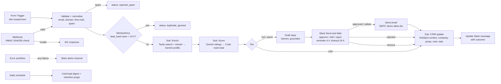
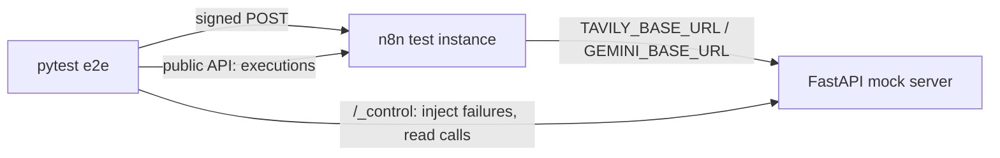

# Architecture

LeadPilot is a set of n8n workflows. n8n (Community Edition, self-hosted, Postgres-backed) is the only runtime. Python appears only in the **test harness** (mock server, pytest end-to-end suite, evaluation, admin scripts). It never runs in the production path.

## 1. Workflow diagram



## 2. Workflows (`/workflows`)

| File | Trigger | Purpose |
|---|---|---|
| `main-lead-intake.json` | Form Trigger + Webhook | Intake, validation, idempotency, orchestration, draft, approval, send. |
| `sub-enrich.json` | Execute Workflow Trigger | Web research and structured company profile. |
| `sub-score.json` | Execute Workflow Trigger | Per-criterion ratings from Gemini, deterministic total and tier in a Code node. |
| `sub-crm-update.json` | Execute Workflow Trigger | HubSpot contact/company upsert, custom properties, note, follow-up task. The only HubSpot-aware workflow, so swapping CRM is contained here. |
| `error-handler.json` | Error Trigger | Posts failures to the alerts channel (execution link, masked email) and marks the lead recoverable. |
| `daily-cold-digest.json` | Schedule (daily) | Cold-lead digest to Slack and purge of lead rows past retention. |

Every workflow except `error-handler` sets `settings.errorWorkflow` to the error handler. Workflow IDs are fixed (set in the exported JSON) so `Execute Workflow` references survive export/import.

## 3. Sub-workflow contracts

All sub-workflows take one item and return one item. Fields not listed are ignored.

### 3.1 Normalised lead (produced by main, input to every sub-workflow)
```json
{
  "lead_id": "ld_7f3a9c2e1b",
  "lead_hash": "sha256(lower(email) + '\\n' + trim(message))",
  "source": "form | webhook | eval",
  "received_at": "2026-11-25T10:00:00Z",
  "name": "Daniel Reyes",
  "email": "daniel.reyes@harborlogistics.example",
  "email_domain": "harborlogistics.example",
  "personal_email": false,
  "company": "Harbor Logistics",
  "website_url": "https://harborlogistics.example",
  "website_domain": "harborlogistics.example",
  "role": "Head of Operations",
  "budget_range": "$25k-$50k",
  "message": "We need a customer portal for shipment tracking..."
}
```

### 3.2 `sub-enrich`
Input: `{ "lead": <normalised lead> }`

Output:
```json
{
  "enrichment_status": "ok | partial | failed",
  "enrichment_note": "website unreachable – profile built from search results only",
  "profile": {
    "what_they_do":  { "value": "Freight logistics", "confidence": "high", "sources": ["https://..."] },
    "industry":      { "value": "Logistics", "confidence": "high", "sources": ["https://..."] },
    "size_estimate": { "value": "~180 employees", "confidence": "medium", "sources": ["https://..."] },
    "location":      { "value": "Rotterdam, Singapore", "confidence": "medium", "sources": ["https://..."] },
    "notable_facts": [ { "fact": "Launched a cold-chain service in 2026", "confidence": "medium", "sources": ["https://..."] } ]
  },
  "sources": [ { "url": "https://...", "title": "..." } ],
  "usage": { "llm_input_tokens": 0, "llm_output_tokens": 0, "tavily_credits": 0 }
}
```
`failed` means both search and website were unusable; scoring then runs on form data only (`enrichment_failed – scored on form data only`).

### 3.3 `sub-score`
Input: `{ "lead": <normalised lead>, "enrichment": <sub-enrich output> }`

Output:
```json
{
  "criteria": [
    { "key": "industry_fit", "name": "Industry fit", "rating": 3, "weight": 25, "points": 25.0,
      "reason": "Logistics is a target industry", "evidence": "https://..." }
  ],
  "score": 82,
  "tier": "hot | warm | cold",
  "thresholds": { "hot": 70, "warm": 40 },
  "usage": { "llm_input_tokens": 0, "llm_output_tokens": 0 }
}
```
`points = rating / 3 * weight`; `score = round(sum(points) / sum(weights) * 100)`. The model only returns `rating`, `reason` and `evidence`; the Code node computes everything else.

### 3.4 `sub-crm-update`
Input:
```json
{
  "lead": "<normalised lead>",
  "enrichment": "<sub-enrich output>",
  "scoring": "<sub-score output>",
  "decision": {
    "outcome": "approved | approved_edited | rejected | timeout | cold",
    "approver": "U0123",
    "reject_reason": "",
    "email": { "sent": true, "subject": "...", "body": "..." }
  },
  "status": "approved_sent"
}
```
Output:
```json
{ "dry_run": false, "contact_id": "123", "contact_created": true, "company_id": "456",
  "note_id": "789", "task_id": "1011" }
```

## 4. Lead statuses
`received` → `rejected_spam` | `duplicate_ignored` | `scored` (with `enrichment_failed` flag when applicable) → `awaiting_approval` → `approved_sent` | `rejected_by_reviewer` | `needs_manual_follow_up` (timeout) ; `cold_recorded` for cold leads; `error_recoverable` when a step fails after retries (the error workflow sets it and the lead can be replayed from the stored row).

## 5. Config files
| File | Contents |
|---|---|
| `config/icp.json` | Criteria (key, name, description, weight, 0–3 rating guide), tier thresholds, free-mail domains, spam rules (max links, honeypot field name). |
| `config/reply_style.md` | Tone, structure, sign-off, `{{BOOKING_LINK}}` placeholder, forbidden claims. |

The `config/` folder is mounted read-only into n8n at `/home/node/.n8n-files/config` (the only path n8n file nodes may read, via `N8N_RESTRICT_FILE_ACCESS_TO`). Clients edit the files and the next execution picks them up; no re-import needed.

## 6. External services
| Service | Node | Base URL | Auth (credential name) |
|---|---|---|---|
| Tavily | HTTP Request | `$env.TAVILY_BASE_URL` | `Tavily API` (header auth) |
| Gemini | HTTP Request | `$env.GEMINI_BASE_URL` | `Gemini API` (header auth `x-goog-api-key`) |
| HubSpot | HubSpot node | – | `HubSpot` (app token) |
| Slack | Slack node | – | `Slack Bot` |
| Email | Send Email (SMTP) | – | `SMTP` |

Every external-call node: `retryOnFail: true`, `maxTries ≥ 3`, `waitBetweenTries` set, and a request timeout. CI enforces this (`scripts/lint_workflows.py`).

## 7. Test harness

With `DRY_RUN=true` the HubSpot, Slack and email nodes are skipped and their would-be payloads are returned in the execution data, which the tests assert on.
